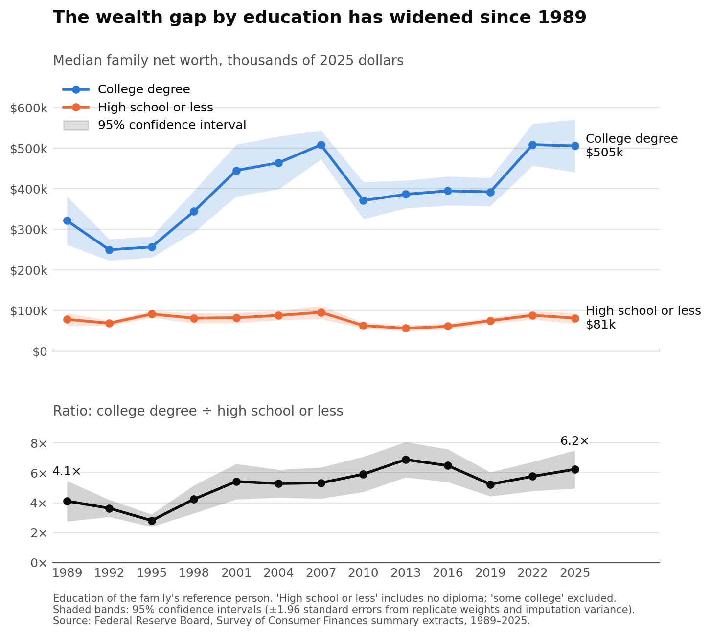

# The US wealth gap by education, 1989–2025

How has the wealth gap between college-educated families and families with a
high school education or less changed since 1989?



`figures/networth_gap.png` shows median family net worth, in thousands of 2025
dollars, for two groups across the 13 Survey of Consumer Finances waves
(1989–2025), with 95% confidence intervals:

- **College degree:** the family's reference person has a bachelor's degree or higher.
- **High school or less:** the reference person has no diploma, or a high school
  diploma or GED. "Some college" (including associate degrees) is excluded.

The bottom panel shows the ratio of the two medians. It rose from 4.1× in 1989
to 6.2× in 2025, while the high-school-or-less median stayed flat ($78k to $81k).

## Data

Federal Reserve Board, [Survey of Consumer Finances](https://www.federalreserve.gov/econres/scfindex.htm):

- **Summary extract public data** (`scfp{YEAR}s.zip`, Stata format), one file
  per survey. As of the 2025 release, all dollar values are inflation-adjusted
  to 2025 dollars by the Fed. Variables used: `networth`, `edcl` (education
  category), `wgt` (weight).
- **Replicate weight files** (`scf{YEAR}rw1s.zip`; two-digit years before 2001)
  for standard errors.

Notes:

- **Education is the household's reference person's**, not the parents'. The
  sample is all families, not only families with children.
- **Point estimates** pool all five implicates, as the Fed does. They reproduce
  the medians in the Fed's historical Table 4 (public data).
- **Standard errors** follow the SCF codebook's MEANIT procedure (see
  `scf_se.py`): imputation variance across implicates plus sampling variance
  from 999 bootstrap replicates. The 2022 and 2025 values are within 2% of the
  Fed's published standard errors.
- The Fed's own figures from internal data differ slightly (e.g. a 2025
  college median of $505.4k vs. $505.0k here), because the public data are
  altered to protect respondents' identities.

## Rerunning

Requires Python 3.

```bash
pip install -r requirements.txt
python get_data.py
python plot.py
```

- `get_data.py` downloads about 400 MB into `data/raw/` on the first run
  (git-ignored; files already present are skipped). It writes
  `data/networth_by_education.csv` (median and mean net worth with standard
  errors, and each group's share of families, by year) and
  `data/networth_ratio.csv` (the ratio of medians with its standard error).
- `plot.py` reads those CSVs and writes `figures/networth_gap.png`.

## Files

| File | Purpose |
|---|---|
| `get_data.py` | Download SCF files and compute estimates |
| `scf_se.py` | Standard errors from replicate weights and implicates |
| `plot.py` | Draw the figure |
| `data/*.csv` | Computed estimates |
| `figures/networth_gap.png` | The figure |
